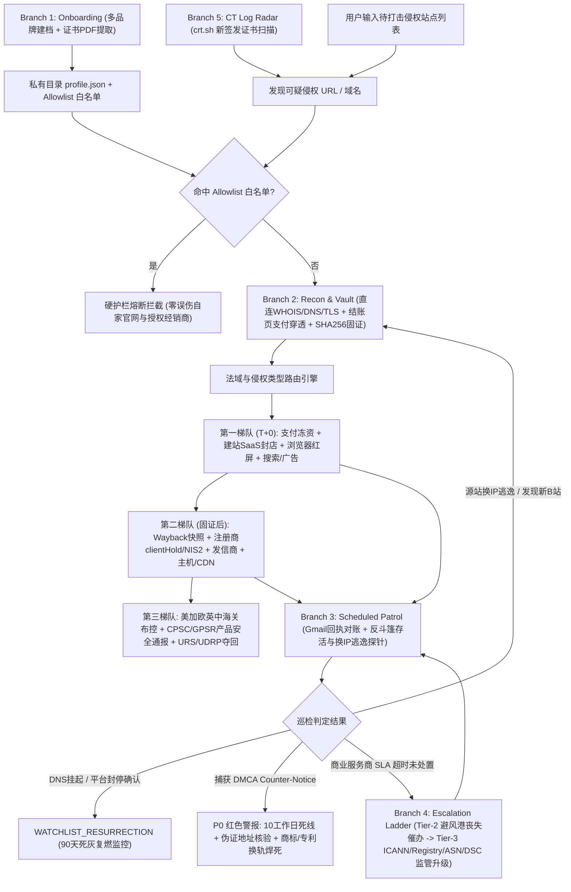

# `brand-takedown` — 通用品牌反假冒与全周期持续维权引擎 Skill

`brand-takedown` 是一个面向 **Google Antigravity**（及兼容 `SKILL.md` 规范的 Agent 环境）构建的 **100% 品牌无关 (Brand-Agnostic)、零第三方包依赖、支持欧美中多法域精准路由与全生命周期状态追踪** 的知识产权维权与反假冒打击 Skill。

它专为解决跨境品牌常见的三大顽疾而设计：
1. **品牌独立站 1:1 克隆与抢注钓鱼 (`Brand Impersonation & Typosquatting`)**：像素级冒充品牌官网骗取消费者货款与信用卡信息。
2. **多品类欺诈店上架假冒伪劣商品 (`Counterfeit Storefronts`)**：利用建站 SaaS 批量铺设低价假货链接，损害品牌声誉并在高危品类（如大功率锂电载具、电子电器、儿童用品）引发严重安全合规连带风险。
3. **虚假物流追踪配套诈骗站 (`Fake Logistics / Scam Enablers`)**：配合假单号伪造物流轨迹，拖延消费者信用卡拒付 (`Chargeback`) 争议窗口。

> **隐私与数据物理隔离承诺**：本仓库仅包含通用的工作流路由、纯标准库取证/状态机脚本、多法域法务参考手册与脱敏文书模板，**不包含任何具体品牌的权利证书、私有配置或案件记录**。运行时产生的所有品牌档案与案件证据均存储在仓库外部的用户私有数据目录中，并通过 `.gitignore` 严格物理隔离。

---

## 一、 核心能力亮点

- **一套引擎兼容无限品牌 (`Multi-Brand Registry`)**：支持通过结构化问答 + 自动解析用户提供的商标/外观专利/发明专利 PDF 证书目录，生成独立的 `profile.json` 品牌档案（索引于 `~/.gemini/brand-protection/registry.json`），随时在不同品牌间切换复用。
- **静默取证与支付/AB 收单壳站穿透 (`Forensic Vault & Checkout Probe`)**：
  - 直连采集目标站点的 `WHOIS`、注册商 `Abuse` 邮箱、`DNS (A/AAAA/CNAME/NS/MX/TXT)` 与 `TLS` 证书指纹（`SHA-256`），并与支持可选 `HTTP/SOCKS5` 代理及广告 `Referer` 伪装的页面抓取严格隔离，确保代理节点 IP 绝不污染司法存证链。
  - 自动识别建站 SaaS 底层永久店铺标识（如隐藏的 `.myshopify.com` 域名与 `Shop ID`）、支付网关公钥（`Stripe pk_live_*`、`PayPal Merchant ID`）及黑产同源团伙追踪码（`GA4`、`Meta Pixel`）。
  - 支持在静态源码未暴露收款通道时，联动 `browser` 子代理执行无痕消费者结账页探测，捕获动态加载的收款商户号与隐藏 **AB 收单壳站（B 站）**。
- **严格的欧美中法域与法理分流 (`Strict Legal Routing`)**：
  - 自动区分 **版权盗图/扒代码 (`DMCA 17 U.S.C. § 512`)**、**注册/未注册商标售假 (`Lanham Act 15 U.S.C. §§ 1114, 1125(a)` / `EUTMR` / `UK TMA`)** 与 **外观设计专利 (`EU RCD` / `US Design Patent`)**，严禁拿纯 DMCA 模板去投诉未盗图的商标案导致被平台法务秒拒。
  - 针对欧洲服务商（如 Hetzner、OVHcloud、Hostinger）自动切换援引 **欧盟《数字服务法案》(`Regulation (EU) 2022/2065`, `DSA Article 16`)** 强制非法内容通知机制与 **`EU NIS2 Directive Article 28`** 隐私保护注册人真实身份披露请求。
- **防打草惊蛇三梯队打击编排 (`Anti-Tip-Off Strike Order`)**：强制执行“先本地 `SHA-256` 固证 → 第一梯队断金流（Stripe/PayPal）+ 封 SaaS 店铺（Shopify/店匠/Shopline）+ 挂浏览器红屏（Google Safe Browsing/SmartScreen/Netcraft） → 第二梯队触发 Wayback 公开存档 + 注册商 `clientHold` + 发信商封禁 + CDN/源站主机下架 → 第三梯队海关双向布控与 `URS/UDRP` 域名夺回”。
- **持续推进状态机与三阶超时升级 (`Relentless Patrol & Escalation`)**：
  - 联动 `Gmail` 插件自动检索服务商工单回执、补件要求与 **P0 级 `DMCA Counter-Notice` 反通知预警**（自动跨越周末计算法定 10 个工作日死线，启动“揭露假地址伪证 + 商标/外观专利/支付欺诈换轨焊死”双反制）。
  - 内置反斗篷存活探针（`check_liveness.py`），精准识别黑产切换普通商品伪装页（`SUSPECTED_CLOAKING`）与更换源站 IP 逃逸（`ACTIVE_ESCAPED_INFRA`），杜绝单次 `HTTP 404` 假死误判结案。
  - 对逾期的商业服务商通道（`ENFORCEMENT_SLA`）绝不机械重发原信，自动推进 **Tier-2 丧失避风港豁免与产品安全连带责任严正催办函** 及 **Tier-3 上游监管投诉**（`ICANN Contractual Compliance`、顶级域 `Registry`、上游 `BGP ASN` 机房、欧盟成员国 `Digital Services Coordinator`）；同时将海关与执法备案（`REGULATORY_FILING`）隔离管理，豁免催办循环。
- **新仿冒域名主动雷达 (`CT Log Radar`)**：免费查询全球 `crt.sh` SSL 证书透明度日志，在侵权者刚为新抢注域名签发 HTTPS 证书、尚未投流获客前露头即打。

---

## 二、 全渠道打击矩阵一览

| 梯队 | 打击维度 | 覆盖平台 / 机构与法规依据 | 默认监控属性 |
| :--- | :--- | :--- | :--- |
| **第一梯队 (`T+0`)** | **支付与收单行斩断** | Stripe (`pk_live_*`)、PayPal (`Merchant ID`)、Airwallex、Adyen、Klarna、IACC RogueBlock | `ENFORCEMENT_SLA` (`48h`) |
| **第一梯队 (`T+0`)** | **建站 SaaS 源头封店** | Shopify (锁定 `.myshopify.com` & `Shop ID`)、Shoplazza、Shopline、BigCommerce、Wix | `ENFORCEMENT_SLA` (`48h`) |
| **第一梯队 (`T+0`)** | **反钓鱼与浏览器红屏** | Google Safe Browsing、Microsoft SmartScreen、Netcraft、APWG、Cloudflare Radar | `ENFORCEMENT_SLA` (`48h`) |
| **第一梯队 (`T+0`)** | **搜索引擎与广告截流** | Google Search DMCA、Google Merchant Center / Ads、Bing、Meta Brand Rights、TikTok IP Portal | `ENFORCEMENT_SLA` (`120h`) |
| **第二梯队 (固证后)** | **域名注册商暂停与披露** | Namecheap、GoDaddy、Tucows、Alibaba、Gname 等（`ICANN RAA § 3.18 clientHold` + `EU NIS2 Art. 28` 披露） | `ENFORCEMENT_SLA` (`72h`) |
| **第二梯队 (固证后)** | **发信服务商与假物流站** | MX/SPF 邮件商（Google/M365/Zoho/SendGrid/Klaviyo）反钓鱼封禁、虚假物流站欺诈基础设施关停 | `ENFORCEMENT_SLA` (`72h`) |
| **第二梯队 (固证后)** | **CDN 穿透与源站主机** | Cloudflare 源站披露、北美主机 (`DMCA + Lanham Act`)、欧洲主机 (`EU DSA Art. 16 + EUTMR + RCD`) | `ENFORCEMENT_SLA` (`72h`) |
| **第三梯队 (长效封锁)** | **进出口海关双向拦截** | 美国 `CBP` (`e-Recordation` & `e-Allegations`)、加拿大 `CBSA RFA`、欧盟 27 国 `EUIPO IPEP AFA`、英国 `HMRC AFA`、中国海关总署 `GACC` 出口备案 | `REGULATORY_FILING` |
| **第三梯队 (长效封锁)** | **产品安全监管与域名夺回** | 美国 `CPSC` (`SaferProducts.gov`)、欧盟 `GPSR Regulation (EU) 2023/988` & `Safety Gate`、`URS` 快速暂停、WIPO/Forum `UDRP` 合并仲裁过户 | `REGULATORY_FILING` |

---

## 三、 工作流与状态机架构



---

## 四、 环境要求与安装方法

### 1. 运行环境要求
- **操作系统**：macOS 或 Linux
- **Python 版本**：`Python >= 3.9`（100% 使用标准库，**无需 `pip install` 任何第三方依赖**）
- **系统原生命令行工具**：`whois`、`dig`、`curl`、`openssl`（macOS 系统均已内置）
- **可选增强组件**（在 Antigravity 中开箱即用）：
  - 官方 `Gmail` 插件（用于检索服务商工单回执、校验企业邮箱 `Send-As` 别名及无人值守创建带附件草稿）
  - 内置 `browser` 子代理或本机 `Google Chrome`（用于全页渲染截图固证及匿名结账页支付公钥嗅探）

### 2. 安装方式

#### 方式 A：安装为全局 Skill（推荐，所有工作区随时可用）
```bash
git clone https://github.com/zlxmygit/brand-takedown.git ~/.gemini/config/skills/brand-takedown
```

#### 方式 B：安装到特定项目工作区
```bash
mkdir -p .agents/skills
git clone https://github.com/zlxmygit/brand-takedown.git .agents/skills/brand-takedown
```

---

## 五、 仓库目录结构

```text
brand-takedown/
├── SKILL.md                                  # 顶层触发器、5 大工作流路由、安全护栏与完成标准 (<250行)
├── README.md                                 # 完整架构、安装与 CLI 使用文档
├── .gitignore                                # 严格拦截私有品牌档案、证书、案件记录与邮件附件入库
├── scripts/
│   ├── brand_registry.py                     # 多品牌档案注册、Schema 校验、RFC1123/反斜杠防绕过白名单守卫
│   ├── recon_target.py                       # 源站直连 WHOIS/DNS/TLS 取证、代理隔离抓取、指纹提取与 SHA-256 清单
│   ├── case_manager.py                       # 持久化案件状态机、通道隔离、三阶 SLA 超时计算与 10 工作日反通知死线
│   ├── check_liveness.py                     # 反斗篷存活探针、Safe Page 伪装识别、DNS/IP 迁移逃逸与死灰复燃检测
│   ├── ct_radar.py                           # crt.sh 证书透明度日志增量扫描与拼写变体主动发现雷达
│   └── build_eml.py                          # 生成携带企业域名 From 头与 UTF-8 多附件的标准 RFC 5322 .eml 邮件
├── references/
│   ├── channel-playbook.md                   # 9 大打击通道官方投诉入口、必填要素与三梯队时序手册
│   ├── legal-jurisdictions.md                # 北美/加/欧/英/澳法理路由矩阵（严防混淆 DMCA 版权与商标售假）
│   ├── customs-and-safety.md                 # 美加欧英中海关进出口拦截与高危产品安全 (CPSC/GPSR/Safety Gate) 指南
│   └── escalation-and-counter-notice.md      # 三阶越级监管投诉 (ICANN/Registry/ASN/DSC/URS/UDRP) 与反通知反制 SOP
├── templates/
│   ├── profile.schema.json                   # 通用多品牌档案 JSON Schema 定义
│   ├── notices-saas-payment-phishing.md      # 第一梯队：支付冻资、SaaS 封店、浏览器红屏与假物流站申诉模板
│   ├── notices-registrar-hosting-cdn.md      # 第二梯队：注册商 clientHold + NIS2 披露、北美 DMCA 与欧盟 DSA Art.16 模板
│   └── notices-escalation-chaser.md          # 第三阶段：Tier-2 避风港丧失催办函与 Tier-3 ICANN/DSC 监管升级模板
└── tests/                                    # 31 项纯标准库单元与真机 CLI 集成测试套件
    ├── test_brand_registry.py
    ├── test_case_manager.py
    ├── test_recon_and_radar.py
    ├── test_liveness_and_eml.py
    └── test_skill_integrity.py
```

---

## 六、 Skill 规范元信息与对话触发指南

### 1. Skill 渐进式披露 (`Progressive Disclosure`) 设计
- **Skill 标识符 (`name`)**：`brand-takedown`
- **入口路由文件**：[`SKILL.md`](./SKILL.md)（严格控制在 `< 250` 行预算内，仅保留分支路由、强约束护栏与标准命令调用，避免挤占上下文窗口）。
- **按需加载参考库 (`references/`)**：Agent 仅在命中特定法域、海关或升级阶梯时按需读取对应 Markdown 手册。
- **动态条件模板 (`templates/`)**：严格按案件取证确认的侵权类型（如是否实际盗用原创图片 `COPYRIGHT_CLONE`）动态裁剪法条声明，杜绝套用错误法理。
- **确定性执行层 (`scripts/`)**：所有 URL 清洗、白名单校验、`SHA-256` 哈希计算、跨周末法定工作日推算与状态机读写均交由纯标准库 Python 脚本确定性完成，零幻觉风险。

### 2. 自然语言触发 Prompt 示例

安装本 Skill 后，无需记忆复杂参数，直接在对话中向 Agent 发送自然语言指令即可自动路由至五大工作流分支：

| 目标分支 | 自然语言对话触发示例 |
| :--- | :--- |
| **Branch 1: 多品牌建档 (`Onboarding`)** | *"帮我初始化一个新的品牌维权档案，目标市场是北美和欧洲，商标和外观专利证书 PDF 都在某个文件夹里。"* |
| **Branch 2: 取证与全渠道打击 (`Recon & Strike`)** | *"这几个网站仿冒了我的独立站并在卖假货，帮我全面取证并向支付通道、建站平台、域名注册商和主机商发起申诉。"* |
| **Branch 3: 邮件监控与存活巡检 (`Patrol`)** | *"检查一下 Gmail 里的维权工单回执，探测所有侵权站点是否已经下线或换 IP 逃逸，并汇总最新进展。"* |
| **Branch 4: 超时催办与越级投诉 (`Escalation`)** | *"扫描所有超过 SLA 还没处理的投诉通道，生成 Tier-2 严正催办函或向 ICANN / 欧盟 DSC 升级投诉。"* |
| **Branch 5: 新假站主动发现 (`CT Radar`)** | *"扫描一下证书透明度日志，看看最近有没有新注册并签发 SSL 证书的品牌仿冒域名。"* |

---

## 七、 通用品牌档案 (`profile.json`) 结构示例

首次运行 **Branch 1** 时，Agent 会通过交互式问答与自动解析证书目录在用户私有目录（默认 `~/.gemini/brand-protection/<slug>/profile.json`，**位于本 Git 仓库之外**）生成如下结构的品牌档案（完整校验规则见 [`templates/profile.schema.json`](./templates/profile.schema.json)）：

```json
{
  "brand_slug": "acme-brand",
  "brand_name": "Acme",
  "legal_entity_name_en": "Acme Innovation Technology Co., Ltd.",
  "legal_entity_name_local": "示例创新科技有限公司",
  "entity_address": "100 Innovation Way, Suite 200, Austin, TX 78701, USA",
  "authorized_signatory": {
    "name": "Jane Doe",
    "title": "Head of Brand Protection & Legal",
    "legal_email": "legal@official-acme.example",
    "forwarded_gmail": "brand-ops@gmail.com",
    "phone": "+1-512-555-0199"
  },
  "official_domains": ["official-acme.example"],
  "allowlist_domains": ["authorized-partner.eu", "official-acme-uk.example"],
  "official_product_urls": [
    "https://official-acme.example/products/flagship-x1"
  ],
  "counterfeit_warning_url": "https://official-acme.example/pages/authentic-guarantee",
  "target_markets": ["US", "CA", "EU", "UK", "AU", "CN_EXPORT"],
  "product_risk_profile": {
    "category": "consumer_hardware_lithium",
    "safety_standards": ["UL", "CE", "UN38.3", "EU GPSR"],
    "hazard_statement_en": "Uncertified counterfeit products lack mandatory battery and mechanical safety protections, posing severe fire and consumer injury hazards."
  },
  "trademarks": [
    {
      "jurisdiction": "US",
      "mark_text": "ACME",
      "reg_number": "7000001",
      "status": "registered",
      "nice_classes": [9, 12],
      "expiry_date": "2035-06-01",
      "cert_file_path": "./certificates/US-TM-7000001.pdf"
    }
  ],
  "patents_and_designs": [
    {
      "jurisdiction": "EU",
      "type": "registered_community_design",
      "number": "015000001-0001",
      "title": "Flagship X1 Exterior Design",
      "status": "registered",
      "expiry_date": "2030-06-01",
      "cert_file_path": "./certificates/EU-RCD-015000001.pdf"
    }
  ],
  "copyright_originals": [
    {
      "asset_name": "Official Studio Product Photography & Copywriting",
      "official_source_url": "https://official-acme.example/products/flagship-x1",
      "first_published_date": "2025-01-15",
      "description": "Original hero banners, 360-degree product renders, and specification tables."
    }
  ],
  "keyword_watch_patterns": ["acme", "acmex1", "acmetrack"]
}
```

---

## 八、 企业邮箱 + Gmail 转发与定时巡检闭环

许多品牌采用**企业域名邮箱对外发信**（如 `legal@official-brand.example`，在注册商与平台法务团队中具有极高的权利人可信度），同时将收件转发至 **Gmail** 集中管理。本 Skill 原生支持这一双邮箱架构：

1. **自动回执收割**：通过 `Gmail` 插件按案件域名、注册商 Abuse 邮箱与工单号（`Ticket ID`）检索转发进来的服务商回执，自动调用 `case_manager.py update-channel` 更新状态。
2. **企业域名 `Send-As` 智能分流**：
   - 若连接的 Gmail 已配置并验证企业邮箱的 `Send-As` 发信别名（通过 `gmail sendas list` 自动核验），可直接生成携带企业域名身份的草稿或回复。
   - 若尚未配置 `Send-As`，自动调用 [`scripts/build_eml.py`](./scripts/build_eml.py) 生成包含完整 `From: legal@official-brand.example` 头与多份 PDF/PNG 证据附件的标准 `.eml` 文件，双击即可在企业邮箱客户端一键发出，绝不降级使用个人 `@gmail.com` 裸发正式法务函。
3. **配合 `/schedule` 开启无人值守持续推进**：
   - 可在对话中使用 `/schedule`（或 `/automation`）创建每 **24 小时**运行的后台巡检任务，自动串联 `Gmail 对账 -> check_liveness.py 存活与逃逸探针 -> case_manager.py due 超时扫描 -> ct_radar.py 新域名预警`，实现“不死不休”的全自动闭环跟进。

---

## 九、 CLI 工具使用速查

除自然语言对话外，所有底层脚本均支持独立命令行调用：

### 1. 品牌建档与白名单核验 (`brand_registry.py`)
```bash
# 校验品牌配置 JSON 是否符合 profile.schema.json
python3 scripts/brand_registry.py validate --profile-file ./sample-profile.json

# 注册或更新品牌档案（数据保存在仓库外的私有目录）
python3 scripts/brand_registry.py init \
  --slug my-brand \
  --data-dir ~/.gemini/brand-protection/my-brand \
  --profile-file ./sample-profile.json

# 查看已注册品牌列表
python3 scripts/brand_registry.py list

# 检查某个 URL 是否命中自家官网或授权经销商白名单
python3 scripts/brand_registry.py check-allowlist --slug my-brand --url "https://shop.example.com"
```

### 2. 案件创建、通道跟踪与超时扫描 (`case_manager.py`)
```bash
# 创建侵权案件（自动执行白名单硬拦截与同域名幂等合并）
python3 scripts/case_manager.py create \
  --slug my-brand \
  --url "https://infringing-clone.example/products/item" \
  --types COPYRIGHT_CLONE TRADEMARK_IMPERSONATION COUNTERFEIT_GOODS

# 登记打击通道（区分商业服务商 ENFORCEMENT_SLA 与海关监管 REGULATORY_FILING）
python3 scripts/case_manager.py add-channel \
  --case-dir ~/.gemini/brand-protection/my-brand/cases/CASE-20261112-infringing-clone-example \
  --channel-id registrar_abuse \
  --channel-class ENFORCEMENT_SLA \
  --category registrar \
  --provider "NameCheap, Inc." \
  --endpoint "abuse@namecheap.com" \
  --status SUBMITTED

# 回填服务商邮件回执中的 Ticket 编号
python3 scripts/case_manager.py update-channel \
  --case-dir ~/.gemini/brand-protection/my-brand/cases/CASE-20261112-infringing-clone-example \
  --channel-id registrar_abuse \
  --ticket-ref "NC-123456" \
  --status ACKNOWLEDGED

# 扫描全品牌所有已逾期的商业服务商通道
python3 scripts/case_manager.py due --slug my-brand

# 将逾期通道推进至下一升级阶梯（Tier 1 -> Tier 2 -> Tier 3）
python3 scripts/case_manager.py escalate \
  --case-dir ~/.gemini/brand-protection/my-brand/cases/CASE-20261112-infringing-clone-example \
  --channel-id registrar_abuse

# 记录 P0 级 DMCA 反通知并自动计算跳过周末的 10 个工作日法定死线
python3 scripts/case_manager.py counter-notice \
  --case-dir ~/.gemini/brand-protection/my-brand/cases/CASE-20261112-infringing-clone-example \
  --channel-id shopify_dmca \
  --received-at "2026-11-13T10:00:00Z" \
  --summary "Suspected fake freight-forwarder address"
```

### 3. 静默源站取证与 SHA-256 证据固化 (`recon_target.py`)
```bash
# 执行直连 WHOIS/DNS/TLS 取证 + 页面指纹扫描（支持可选目标市场代理与 Referer 穿透斗篷）
python3 scripts/recon_target.py run \
  --slug my-brand \
  --url "https://infringing-clone.example/" \
  --case-dir ~/.gemini/brand-protection/my-brand/cases/CASE-20261112-infringing-clone-example

# 补充浏览器全页截图后刷新 SHA-256 存证清单并同步报告
python3 scripts/recon_target.py refresh-manifest \
  --case-dir ~/.gemini/brand-protection/my-brand/cases/CASE-20261112-infringing-clone-example

# 在本地固证与第一梯队投诉准备就绪后，触发 Wayback Machine 第三方公开存档
python3 scripts/recon_target.py archive-wayback \
  --slug my-brand \
  --url "https://infringing-clone.example/"
```

### 4. 反斗篷存活巡检与逃逸追杀探针 (`check_liveness.py`)
```bash
# 批量巡检品牌名下所有活跃案件及 90 天死灰复燃观察池案件
python3 scripts/check_liveness.py patrol --slug my-brand
```

### 5. 证书透明度日志新假站主动雷达 (`ct_radar.py`)
```bash
# 增量扫描 crt.sh 捕获包含品牌关键词的新签发 HTTPS 证书域名
python3 scripts/ct_radar.py --slug my-brand
```

### 6. 标准多附件企业签名邮件生成 (`build_eml.py`)
```bash
# 生成带官方企业域名 From 头与多份 PDF/PNG 证据附件的标准 .eml 文件
python3 scripts/build_eml.py \
  --out ./registrar_notice.eml \
  --from-addr "legal@official-brand.example" \
  --to "abuse@namecheap.com" \
  --subject "[DNS ABUSE] Request for Immediate clientHold Suspension" \
  --body-file ./notice_body.txt \
  --attachments ./trademark_cert.pdf ./fullpage_screenshot.png
```

---

## 十、 安全与法律合规硬护栏 (`Safety & Legal Guardrails`)

1. **官方与授权白名单硬熔断**：`brand_registry.py`、`case_manager.py` 与 `recon_target.py` 在入口层统一做反斜杠归一化、`userinfo (@)` 剥离与子域名边界校验，一旦目标 URL 命中 `official_domains` 或 `allowlist_domains` 立即抛错中止，严防误伤自家站点或授权经销商。
2. **伪证罪宣誓 (`Perjury Statement`) 真实性红线**：所有包含 `17 U.S.C. § 512(c)(3)(A)(vi)` 或 `EU DSA Art. 16(2)(c)` 善意及伪证宣誓的文书，仅允许填充品牌档案中核实的真实知识产权编号与真实取证哈希，发送前必须经由权利人或其授权代表确认。
3. **反滥发升级约束**：同一服务商通道在未满约定 `SLA` 窗口（默认 `48h`–`120h`）前严禁重复催促；超时后仅按阶梯生成带原工单号与新增法律风险点的升级函或转交上游监管机构，绝不制造垃圾邮件轰炸导致企业域名信誉受损。
4. **验证门禁合规边界**：在联动浏览器提交公开 Web 表单（如 Shopify、Cloudflare、Safe Browsing）时，若遇到 `CAPTCHA` / `Cloudflare Turnstile` 人机验证门禁，严格遵循平台安全规范停在提交前一步交由人工点击完成，绝不尝试任何绕过或破解手段。
5. **非执业律师免责声明**：本 Skill 生成的多法域通知函、证据包与海关线索材料系自动化法务辅助与行政投诉工具，不构成正式执业律师法律意见（如遇 `DMCA Counter-Notice` 需提起联邦法院诉讼或发起正式 `UDRP` 仲裁，建议同步委托目标司法管辖区执业律师介入）。

---

## 十一、 运行测试套件

本仓库内置 **31 项**纯标准库单元测试与真机 CLI 集成测试（涵盖反斜杠/`@` 白名单绕过防御、CLI 参数注入拦截、代理响应头隔离、macOS `dig` / `LibreSSL` 原生兼容、跨周末法定工作日计算、反斗篷 `Safe Page` 识别、UTF-8 中文证书附件编码以及 100% 品牌/主机路径脱敏检查）：

```bash
python3 -m unittest discover -s tests -v
```
